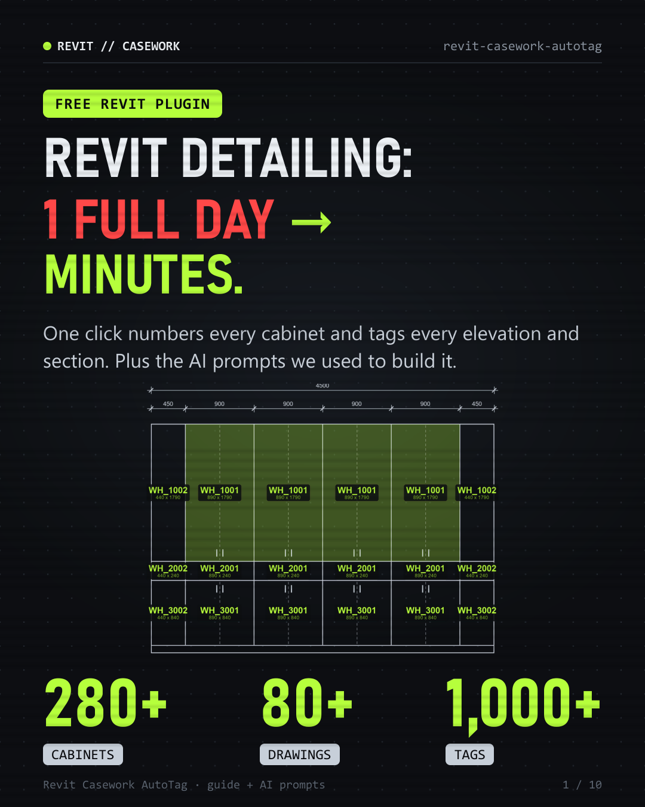
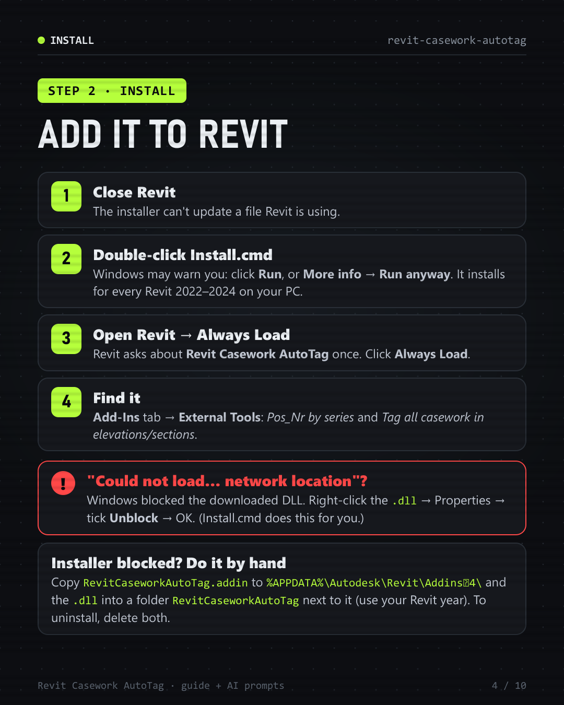
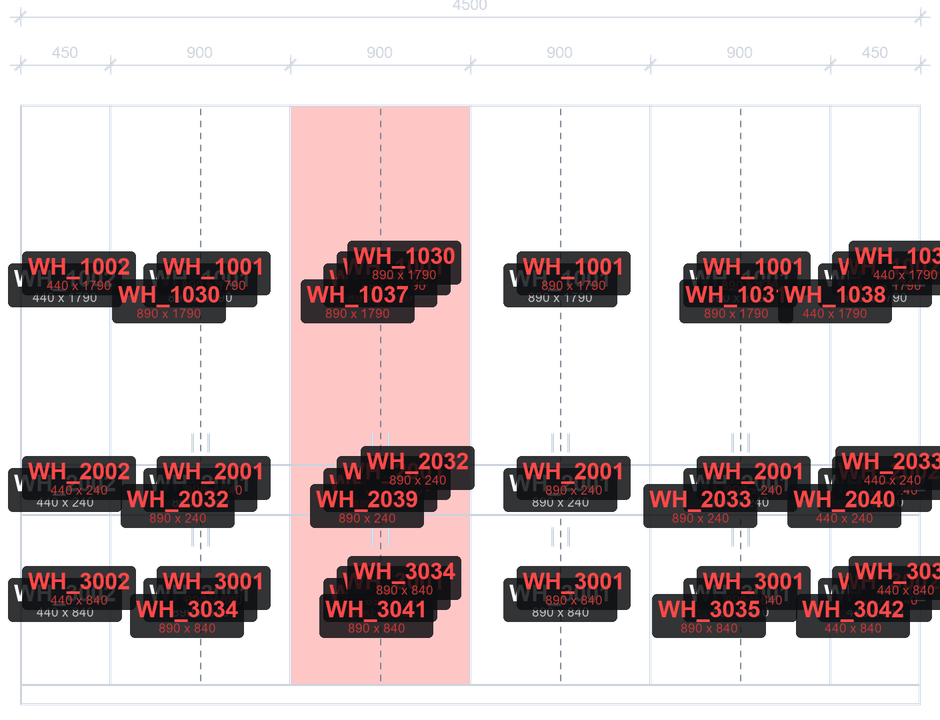
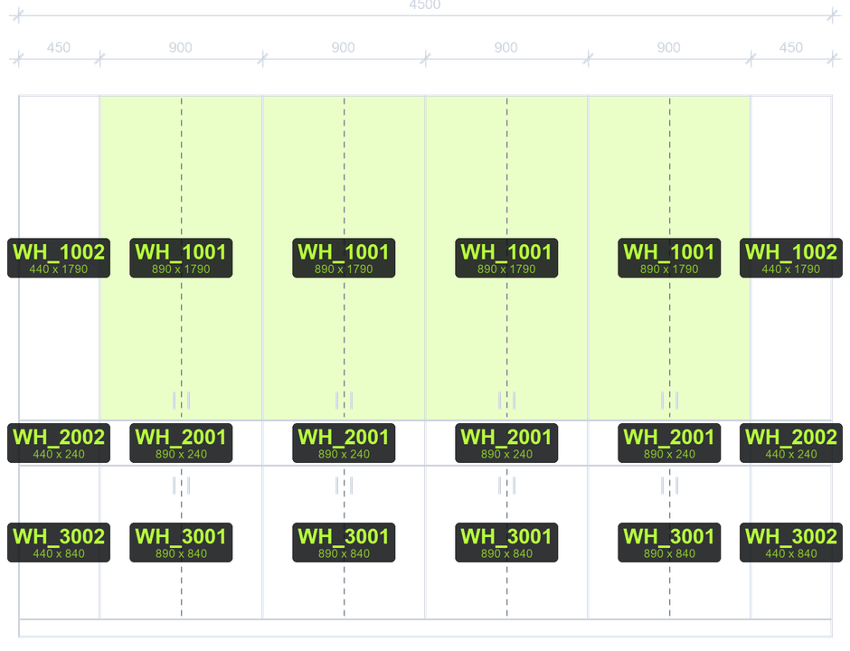

# Revit Casework AutoTag

**Revit detailing: 1 full day → minutes.**
One click numbers every casework cabinet, and a second click tags every elevation and section in the project.

<p align="center"></p>

| 280+ cabinets | 80+ drawings | 1,000+ tags |
|:---:|:---:|:---:|
| numbered in ~2 seconds | every elevation and section | placed in minutes |

## ⬇️ Download

### [**Download Revit-Casework-AutoTag-v1.0.6.zip**](https://github.com/kayyox18/revit-casework-autotag/raw/main/download/Revit-Casework-AutoTag-v1.0.6.zip)

| Works with | Not supported yet |
|---|---|
| ✅ Revit 2022 · 2023 · 2024 (Windows) | ❌ Revit 2025 and newer |

📘 **Full guide with screenshots and the AI prompts we used:** [Revit-Casework-AutoTag-guide.pdf](docs/Revit-Casework-AutoTag-guide.pdf)

The ZIP contains only the compiled add-in, with no source code:

| File | What it is |
|---|---|
| `RevitCaseworkAutoTag.dll` | the add-in |
| `RevitCaseworkAutoTag.addin` | tells Revit where the add-in is |
| `Install.cmd` | 1-click installer |
| `READ ME FIRST.txt` | these install steps, offline |

---

## Install in Revit (2 minutes)

1. **Download** the ZIP above. Open the link on your PC, not your phone.
2. **Unzip:** right-click the ZIP → **Extract All** → **Extract**.
3. **Close Revit.**
4. **Double-click `Install.cmd`.**
   - If Windows asks *"Do you want to run this file?"*, click **Run**.
   - If you see *"Windows protected your PC"*, click **More info → Run anyway**.
   - The installer adds the plugin to every Revit 2022, 2023 and 2024 on your PC. It also removes Windows' "downloaded from the internet" block from the DLL.
5. **Open Revit.** When it asks about the add-in **Revit Casework AutoTag**, click **Always Load**.
6. **Find it:** **Add-Ins** tab → **External Tools**. You'll see:
   - **Pos_Nr by series**
   - **Tag all casework in elevations/sections**

<p align="center"></p>

### Revit says "could not load… network location"?
Windows blocked the downloaded DLL. Right-click `RevitCaseworkAutoTag.dll` → **Properties** → tick **Unblock** → **OK**, then restart Revit. `Install.cmd` normally does this for you.

### Installer blocked? Install by hand
1. Open `%APPDATA%\Autodesk\Revit\Addins\2024\`. Paste that into the File Explorer address bar, and use your Revit year.
2. Copy `RevitCaseworkAutoTag.addin` into that folder.
3. Make a folder called `RevitCaseworkAutoTag` there, and copy `RevitCaseworkAutoTag.dll` into it.
4. Unblock the DLL as described above, then open Revit.

### Uninstall
Delete `RevitCaseworkAutoTag.addin` and the `RevitCaseworkAutoTag` folder from `%APPDATA%\Autodesk\Revit\Addins\<year>\`.

---

## What it does

- **Numbers every cabinet.** Writes `Pos_Nr` by series: upper cabinets 1001+, middle 2001+, lower 3001+.
- **Same size + same colour = same number.** Sizes are compared to the nearest mm, so identical cabinets never get two numbers.
- **Tags every elevation and section in one run.** It only tags cabinets you can actually see (no side-on or hidden ones), so tags never pile up.
- **Safe to run again.** A second run adds 0 tags. No duplicates.

| Before: by hand | After: 1 click |
|:---:|:---:|
|  |  |

## Set up your families (one time)

| What | The plugin reads |
|---|---|
| Category | Your cabinets are **Casework** families |
| Series | The type's `Description` contains **Above**, **Middle** or **Lower**. That picks the 1000 / 2000 / 3000 series |
| Number goes here | An instance parameter `Pos_Nr` (text or integer). Colours starting `M_SS_` / `M_GI_` / `M_GL_` get a short prefix, e.g. `SS_1001` |
| Colour | A colour/material text parameter `Farbe`. Without it, cabinets match on size only |
| Size | `Width` / `Height` on the instance or type (also `Breite` / `Höhe`), or Revit's built-in family width/height |
| Tag | A **Casework Tag** family loaded in the project that shows `Pos_Nr` |

## Use it: 2 clicks

1. **Add-Ins → External Tools → Pos_Nr by series.** Every cabinet gets its number, and a pop-up shows how many were updated.
2. **Add-Ins → External Tools → Tag all casework in elevations/sections.** Every visible cabinet in every elevation and section gets a tag.

**Good to know**
- Already have old tags? Delete them first: select one tag → right-click → **Select All Instances → In Entire Project** → Delete.
- On big projects, Revit shows "Not Responding" for a few minutes. Just wait.

## Why 1190 ≠ 1190 (the bug we had to beat)

Revit stores lengths in feet, with tiny floating-point noise. The same 1190 mm cabinet can be stored as two different values:

```
3.9041994760655143 ft
3.9041994750656386 ft
```

Compared to 17 decimals, those count as "different", so identical cabinets got new numbers. Two more bugs were fixed at the same time:

- **Size check:** sizes are now rounded to the nearest mm before comparing.
- **Duplicate tags:** a Revit 2023+ API change made every run stack a second set of tags (430 → 860). Now a second run adds 0.
- **Overlapping tags:** 2,122 → 0. Only cabinets that face the view and aren't hidden behind something get a tag.

## 4 AI prompts we actually used

We built and tested this with an AI coding agent (Claude Code) running on the same PC as Revit.

1. **Run Revit yourself**
   > You can run Revit yourself. Write a small test add-in that waits until the model is open, runs my command, writes the results to a log file and closes Revit. Start Revit from the command line with a **copy** of my model. Never touch my own file.
2. **Find the real cause**
   > This add-in gives identical cabinets different numbers. Run it on the test model, group cabinets by size and material, and print the raw values it compares. Find the real cause before you change any code.
3. **Fix it + prove it**
   > Fix it, rebuild the DLL and run it on every elevation and section. Give me a before/after table: duplicate numbers, overlapping tags, untagged cabinets. Export the worst view before and after as PNG.
4. **Ship it**
   > Make a one-click installer for Revit 2022–2024 that copies the DLL and .addin to the right folder and unblocks the DLL. Show a clear message if Revit is still open.

## 6 lessons we learned

1. Never compare Revit lengths directly. Round them to the mm first.
2. Revit's API changes between versions. Test in the exact version your team uses.
3. Tag only what the view really shows: facing the view, not hidden behind a wall.
4. Make every command safe to run twice.
5. Windows blocks downloaded DLLs. Ship an installer that unblocks them.
6. Test on a copy of the model, never the live project.

## Got a Revit task your team does by hand every week?

Send us a DM with:
- what the task is (numbering, tagging, sheets, schedules, exports…)
- a screenshot or a small sample file (a copy, never your live project)
- your Revit version

We'll tell you if it can be automated, and how fast. **Follow for more AI × Revit automation.**

---

<sub>Provided as is, without warranty. Always test on a copy of your project first.</sub>
